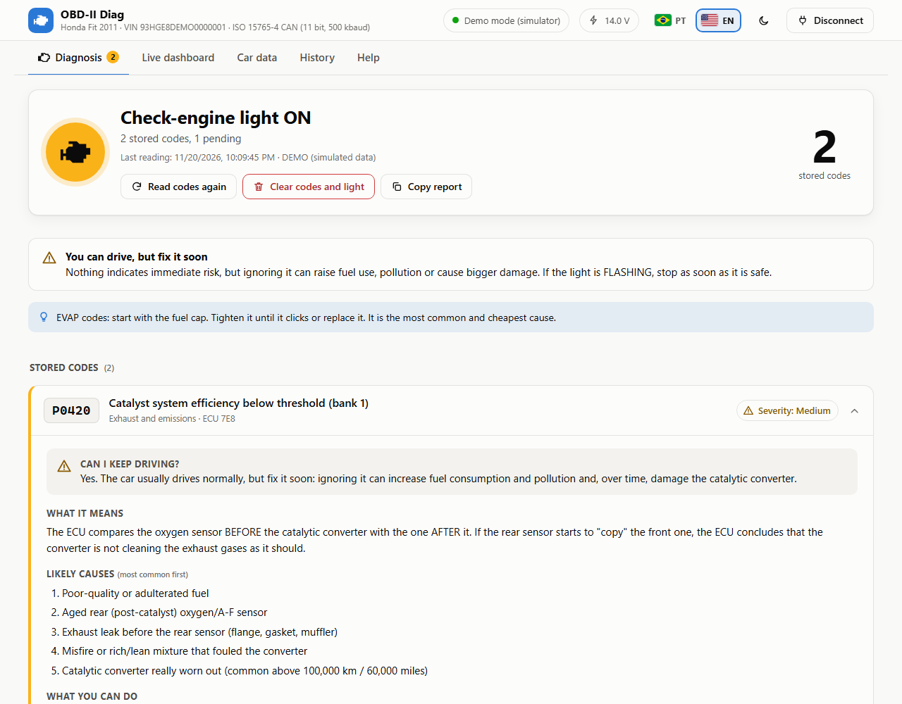
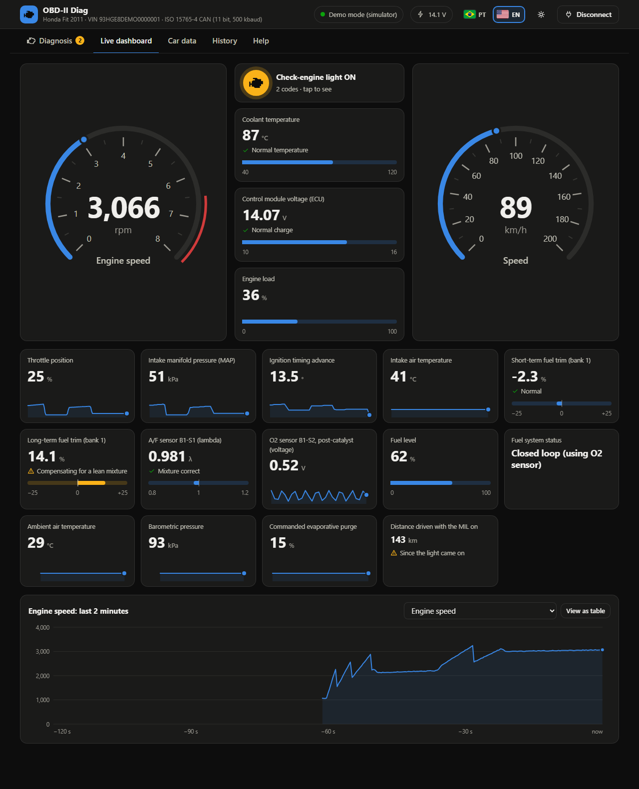

# OBD-II Diag

**Read your car's trouble codes, watch live engine data and turn off the check-engine light — from your laptop, with a cheap ELM327 Bluetooth or USB adapter.**

🇺🇸 English · [🇧🇷 Português](README.pt-BR.md)



- **Plain-language diagnosis.** Every trouble code comes with what it means, *can I keep driving?*, the most likely causes (most common first) and what you can do about it. Freeze-frame data and the readiness monitors are shown too.
- **Live dashboard.** RPM and speed gauges, coolant temperature, battery voltage, fuel trims, throttle, MAP, O2 sensors… with sparklines and a 2-minute chart. Only the sensors your car really supports are shown.
- **Clear codes / turn the light off** with an explicit confirmation. A copy of the codes is saved in the History tab first.
- **Works offline and stays on your computer.** No cloud, no account, no telemetry. The page is served only on `127.0.0.1`.
- **No car at hand? Try the demo.** A built-in simulator plays a car with a few faults (`demo.bat` / `./demo.sh`).
- **English and Portuguese** (flag buttons in the header), light and dark theme, phone-sized layouts.
- **Nothing to install.** Pure Python standard library; [pySerial](https://github.com/pyserial/pyserial) is bundled. Windows and Linux.

## Quick start

You need **Python 3.8 or newer**. On Windows you can skip this: `run.bat` offers to fetch a portable copy by itself.

**Windows**

```powershell
git clone https://github.com/phanchieta/obdII-diag.git
cd obdII-diag
.\run.bat
```

**Linux**

```bash
git clone https://github.com/phanchieta/obdII-diag.git
cd obdII-diag
./run.sh
```

Your browser opens on <http://127.0.0.1:8765/>. Close the terminal window (or press `Ctrl+C`) to stop.

**No adapter yet?** Run `demo.bat` (Windows) or `./demo.sh` (Linux) to see everything working with the simulator.

> **Python on Windows.** `run.bat` looks for Python in this order: the portable copy in `runtime\`, a Python 3.8+ already installed
> on the PC, and otherwise it asks whether to download the official *embeddable* Python (11 MB, from python.org) into `runtime\`.
> Nothing is installed on your system and no administrator rights are needed; delete `runtime\` to remove it.
> The download is checked against a pinned SHA-256 and the Python Software Foundation signature
> ([`scripts/get-python-windows.ps1`](scripts/get-python-windows.ps1)).

## Connect your adapter

1. Plug the adapter into the car's OBD-II socket (usually under the dashboard, on the driver's side) and turn the ignition **ON**.
   Engine off is enough to read and clear codes; start the engine to see live data.
2. **Pair it with your computer** (PIN `1234`; some adapters use `0000`, `6789` or `1111`):
   - **Windows 11:** *Settings → Bluetooth & devices → Devices → Device settings → Bluetooth devices discovery → **Advanced***, then *Add device → Bluetooth* and pick `OBDII`
     (or `V-LINK`, `ELM327`…). Windows 11's default list hides generic devices like this one, which is why people think the adapter "does not show up".
   - **Linux:** `bluetoothctl` → `scan on` → `pair AA:BB:CC:DD:EE:FF` → `trust AA:BB:CC:DD:EE:FF`. USB adapters appear as `/dev/ttyUSB0`; if you get *permission denied*, run `sudo usermod -aG dialout $USER` and log in again.
3. Run `run.bat` / `./run.sh`. It connects by itself; otherwise click **Connect → Automatic**. The **Help** tab repeats these steps and has a **Diagnose Bluetooth** button that tells you whether the computer can see the adapter.

## Command line

`run.bat`, `run.sh` and `python run.py` accept the same options:

| Option | What it does |
| --- | --- |
| `--demo` | Use the built-in car simulator (no adapter needed) |
| `--scenario NAME` | With `--demo`: `check_engine` (default), `misfire`, `healthy`, `engine_off`, `ignition_off`, `recurring_fault` |
| `--car "Honda Fit 2011"` | Name of your vehicle. When it contains "Honda", Honda-specific tips are added (also settable in the Connect dialog or with `OBD2DASH_CAR`) |
| `--com PORT` | Use a specific port: `COM5`, `/dev/ttyUSB0`, or on Linux `bt://AA:BB:CC:DD:EE:FF` (Bluetooth socket, no root needed) |
| `--port N` | Local web port (default `8765`; the next free one is used if it is busy) |
| `--no-browser` | Do not open the browser automatically |

Your history (one JSON file per reading) and log are stored in `./data/`. Set `OBD2DASH_DATA` to keep them elsewhere.

## Compatibility

- **Cars:** anything that speaks generic OBD-II / EOBD — roughly petrol cars from 2001 and diesels from 2004 in Europe, and all cars sold in the US since 1996.
  The adapter detects the protocol by itself (CAN, ISO 9141-2, KWP2000, J1850); only CAN has been tried with a real car so far.
- **Adapters:** ELM327 and compatible clones using classic Bluetooth (serial profile) or USB. **Not supported:** Bluetooth Low Energy-only adapters and Wi-Fi adapters.
- **Trouble codes:** hand-written guidance for the most common ones (with Honda notes), generated guidance for families such as misfires, O2 sensors and injectors,
  and generic English titles for about 8,000 more.
- **Scope:** engine/emissions (powertrain) data. It does not talk to ABS, airbag or body modules.

| Platform | Status |
| --- | --- |
| Windows 11 + real car (2011 Honda Fit, ELM327 mini Bluetooth) | Tested end to end |
| Windows 10 | Same code path, not tested by the author |
| Linux | Automated tests and the simulator run on Ubuntu (CI + WSL). The Bluetooth socket path is unit-tested with a socket pair but **has not been tried with a real adapter yet** — reports welcome |
| macOS | Not tested (USB / Bluetooth serial ports should work with `--com`) |

## Good to know

- **A code points to a circuit or a system, not necessarily to the part that failed.** Use the explanations as a starting point, not as a verdict.
- **Clearing codes also resets the car's readiness monitors.** An emissions inspection may refuse a car whose monitors have not completed again (usually after a few days of mixed driving). Note the codes down first — the app saves a copy.
- If the fault is still there, the light comes back and the app notices by itself.
- The built-in terminal (Car data tab) only accepts a few read-only adapter commands and read-only OBD requests.
- Use at your own risk; see the [license](LICENSE). This is not a substitute for a qualified mechanic.

## Troubleshooting

| Symptom | Try this |
| --- | --- |
| The adapter does not appear when pairing (Windows 11) | Set *Bluetooth devices discovery* to **Advanced** (see above). Press *Diagnose Bluetooth* in the Help tab: if the adapter is listed under "nearby", the computer sees it and only the pairing is missing |
| *No adapter found* | Pair first, then press **Refresh list** in the Connect dialog. Windows must show an *outgoing* COM port (the one named after the adapter), not the *incoming* one |
| *Car not answering* | Ignition on, adapter fully seated. Some cars only wake the OBD bus with the ignition in position II |
| The port is busy | The app picks the next free web port by itself; look at the address printed in the terminal |
| Windows SmartScreen warns about `run.bat` | Only happens with a *Download ZIP*. Use `git clone`, or right-click the ZIP → Properties → *Unblock* before extracting |

## For developers

```text
run.bat / run.sh / run.py    launchers          demo.bat / demo.sh   simulator
obd2dash/                    the application — Python standard library only
  elm327.py obd.py pids.py protocol.py   adapter commands and OBD-II decoding
  session.py server.py                   worker thread, HTTP + Server-Sent Events API
  kb.py kb/                              trouble-code knowledge base (pt / en)
  i18n.py messages.py                    server-side translations
web/                         the dashboard (vanilla JS); web/i18n/*.json holds the interface texts
vendor/                      pySerial 3.5, bundled
scripts/                     get-python-windows.ps1
tests/                       python -m unittest discover -s tests -t .
```

- Run the tests: `python -m unittest discover -s tests -t .` (about 25 seconds; they never connect to a real adapter).
- Translations live in four places: `web/i18n/*.json` (interface), `obd2dash/messages.py` (server texts), `obd2dash/kb/curated.*.txt` (trouble-code guidance)
  and `obd2dash/pids.py` (sensor names). The tests keep every language complete and consistent.
- The code follows one rule for text: anything the user reads is a `Msg` carrying every language, and the browser picks one.



## License

[MIT](LICENSE). Bundled third-party code and data are listed in [THIRD_PARTY_NOTICES.md](THIRD_PARTY_NOTICES.md).
