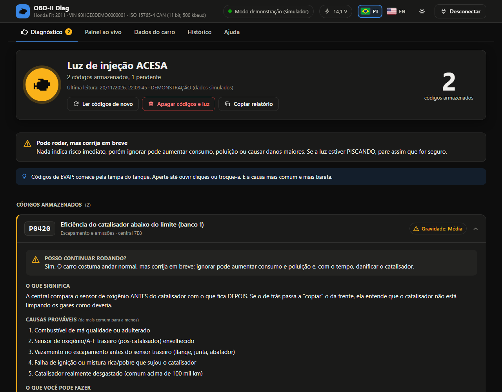
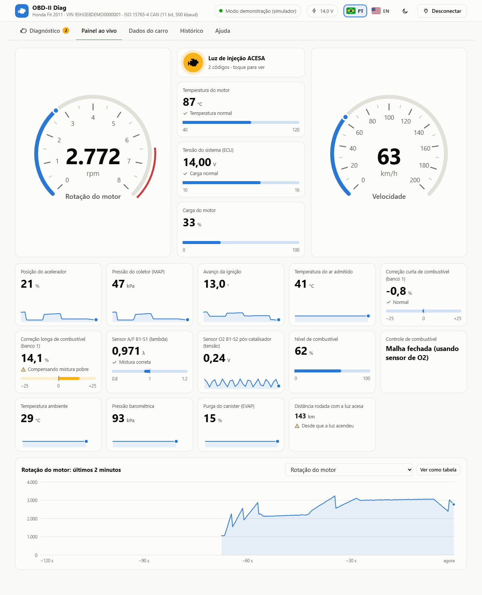

# OBD-II Diag

**Leia os códigos de falha do seu carro, acompanhe os dados do motor ao vivo e apague a luz de injeção — pelo notebook, com um leitor ELM327 Bluetooth ou USB baratinho.**

[🇺🇸 English](README.md) · 🇧🇷 Português



- **Diagnóstico em português claro.** Cada código vem com o que significa, *posso continuar rodando?*, as causas mais prováveis (as mais comuns primeiro) e o que fazer. Também mostra os dados congelados da falha (freeze frame) e os monitores de prontidão.
- **Painel ao vivo.** Velocímetro e conta-giros, temperatura do motor, tensão da bateria, correções de combustível, acelerador, MAP, sondas de O2… com minigráficos e um gráfico dos últimos 2 minutos. Só aparecem os sensores que o seu carro realmente tem.
- **Apagar códigos / luz de injeção** com confirmação explícita. Antes, uma cópia dos códigos fica salva na aba Histórico.
- **Funciona offline e fica no seu computador.** Sem nuvem, sem conta, sem telemetria. A página só é servida em `127.0.0.1`.
- **Sem carro por perto? Teste a demonstração.** Um simulador embutido faz o papel de um carro com algumas falhas (`demo.bat` / `./demo.sh`).
- **Português e inglês** (bandeirinhas no topo), tema claro e escuro, telas de celular.
- **Nada para instalar.** Só a biblioteca padrão do Python; o [pySerial](https://github.com/pyserial/pyserial) já vai junto. Windows e Linux.

## Começando

Você precisa do **Python 3.8 ou mais novo**. No Windows pode pular: o `run.bat` oferece baixar uma cópia portátil sozinho.

**Windows**

```powershell
git clone https://github.com/phanchieta/obdII-diag.git
cd obdII-diag
.\run.bat
```

**Linux**

```bash
git clone https://github.com/phanchieta/obdII-diag.git
cd obdII-diag
./run.sh
```

O navegador abre em <http://127.0.0.1:8765/>. Feche a janela do terminal (ou `Ctrl+C`) para encerrar.

**Ainda sem o leitor?** Rode `demo.bat` (Windows) ou `./demo.sh` (Linux) para ver tudo funcionando com o simulador.

> **Python no Windows.** O `run.bat` procura o Python nesta ordem: a cópia portátil em `runtime\`, um Python 3.8+ já instalado no PC e,
> se não achar nenhum, pergunta se pode baixar o Python *embeddable* oficial (11 MB, do python.org) para `runtime\`.
> Nada é instalado no sistema e não precisa de administrador; apague `runtime\` para remover.
> O download é conferido com um SHA-256 fixo e com a assinatura da Python Software Foundation
> ([`scripts/get-python-windows.ps1`](scripts/get-python-windows.ps1)).

## Conectando o leitor

1. Encaixe o leitor na tomada OBD-II do carro (em geral embaixo do painel, do lado do motorista) e ligue a ignição (**posição II**, sem ligar o motor).
   Com o motor desligado já dá para ler e apagar códigos; ligue o motor para ver os dados ao vivo.
2. **Pareie com o computador** (senha `1234`; alguns usam `0000`, `6789` ou `1111`):
   - **Windows 11:** *Configurações → Bluetooth e dispositivos → Dispositivos → Configurações de dispositivo → Descoberta de dispositivos Bluetooth → **Avançado***, depois *Adicionar dispositivo → Bluetooth* e escolha `OBDII`
     (ou `V-LINK`, `ELM327`…). A lista padrão do Windows 11 esconde dispositivos genéricos como esse, por isso muita gente acha que o leitor "não aparece".
   - **Linux:** `bluetoothctl` → `scan on` → `pair AA:BB:CC:DD:EE:FF` → `trust AA:BB:CC:DD:EE:FF`. Leitores USB aparecem como `/dev/ttyUSB0`; se der *permission denied*, rode `sudo usermod -aG dialout $USER` e entre de novo na sessão.
3. Rode `run.bat` / `./run.sh`. Ele conecta sozinho; se não, clique em **Conectar → Automático**. A aba **Ajuda** repete esses passos e tem um botão **Diagnosticar o Bluetooth** que mostra se o computador enxerga o leitor.

## Linha de comando

`run.bat`, `run.sh` e `python run.py` aceitam as mesmas opções:

| Opção | O que faz |
| --- | --- |
| `--demo` | Usa o simulador de carro embutido (não precisa do leitor) |
| `--scenario NOME` | Com `--demo`: `check_engine` (padrão), `misfire`, `healthy`, `engine_off`, `ignition_off`, `recurring_fault` |
| `--car "Honda Fit 2011"` | Nome do seu veículo. Se contiver "Honda", entram dicas específicas da Honda (também dá para informar na janela Conectar ou com `OBD2DASH_CAR`) |
| `--com PORTA` | Usa uma porta específica: `COM5`, `/dev/ttyUSB0` ou, no Linux, `bt://AA:BB:CC:DD:EE:FF` (socket Bluetooth, sem root) |
| `--port N` | Porta web local (padrão `8765`; se estiver ocupada, usa a próxima livre) |
| `--no-browser` | Não abre o navegador sozinho |

O histórico (um arquivo JSON por leitura) e o log ficam em `./data/`. Use `OBD2DASH_DATA` para guardá-los em outro lugar.

## Compatibilidade

- **Carros:** qualquer um que fale OBD-II / EOBD genérico — grosso modo carros a gasolina a partir de 2001 e diesel a partir de 2004 na Europa, e todos os vendidos nos EUA desde 1996.
  O próprio leitor detecta o protocolo (CAN, ISO 9141-2, KWP2000, J1850); até agora só o CAN foi testado num carro de verdade.
- **Leitores:** ELM327 e clones compatíveis, por Bluetooth clássico (perfil serial) ou USB. **Não suporta:** leitores só Bluetooth Low Energy e leitores Wi-Fi.
- **Códigos de falha:** explicações escritas à mão para os mais comuns (com observações da Honda), explicações geradas para famílias como falhas de ignição, sondas de O2 e bicos,
  e títulos genéricos em inglês para cerca de 8.000 outros.
- **Escopo:** dados de motor/emissões (powertrain). Não conversa com ABS, airbag nem módulos da carroceria.

| Plataforma | Situação |
| --- | --- |
| Windows 11 + carro de verdade (Honda Fit 2011, ELM327 mini Bluetooth) | Testado de ponta a ponta |
| Windows 10 | Mesmo código, não testado pelo autor |
| Linux | Testes automatizados e simulador rodam no Ubuntu (CI + WSL). O caminho por socket Bluetooth é testado com um par de sockets, mas **ainda não foi testado com um leitor real** — relatos são bem-vindos |
| macOS | Não testado (portas seriais USB / Bluetooth devem funcionar com `--com`) |

## Bom saber

- **Um código aponta para um circuito ou sistema, não necessariamente para a peça com defeito.** Use as explicações como ponto de partida, não como sentença.
- **Apagar os códigos também zera os monitores de prontidão do carro.** Numa inspeção de emissões, o carro pode ser reprovado até os monitores completarem de novo (em geral alguns dias de uso misto). Anote os códigos antes — o app guarda uma cópia.
- Se o defeito continuar lá, a luz volta e o app percebe sozinho.
- O terminal embutido (aba Dados do carro) só aceita alguns comandos de leitura do leitor e consultas OBD somente de leitura.
- Use por sua conta e risco; veja a [licença](LICENSE). Não substitui um mecânico qualificado.

## Problemas comuns

| Sintoma | O que tentar |
| --- | --- |
| O leitor não aparece ao parear (Windows 11) | Mude a *Descoberta de dispositivos Bluetooth* para **Avançado** (veja acima). Use o botão *Diagnosticar o Bluetooth* na aba Ajuda: se o leitor aparecer em "por perto", o computador o enxerga e só falta parear |
| *Nenhum leitor encontrado* | Pareie primeiro e depois use **Atualizar lista** na janela Conectar. O Windows precisa mostrar uma porta COM de *saída* (a que leva o nome do leitor), não a de *entrada* |
| *Carro não responde* | Ignição ligada e leitor bem encaixado. Alguns carros só acordam o barramento OBD com a ignição na posição II |
| A porta está ocupada | O app escolhe sozinho a próxima porta web livre; veja o endereço impresso no terminal |
| O SmartScreen do Windows reclama do `run.bat` | Só acontece com *Download ZIP*. Use `git clone`, ou clique com o botão direito no ZIP → Propriedades → *Desbloquear* antes de extrair |

## Para quem quer mexer no código

```text
run.bat / run.sh / run.py    lançadores         demo.bat / demo.sh   simulador
obd2dash/                    o aplicativo — só biblioteca padrão do Python
  elm327.py obd.py pids.py protocol.py   comandos do leitor e decodificação OBD-II
  session.py server.py                   thread de trabalho, API HTTP + Server-Sent Events
  kb.py kb/                              base de conhecimento dos códigos (pt / en)
  i18n.py messages.py                    traduções do lado do servidor
web/                         o painel (JS puro); web/i18n/*.json guarda os textos da interface
vendor/                      pySerial 3.5, já incluído
scripts/                     get-python-windows.ps1
tests/                       python -m unittest discover -s tests -t .
```

- Rodar os testes: `python -m unittest discover -s tests -t .` (cerca de 25 segundos; nunca conectam a um leitor de verdade).
- As traduções ficam em quatro lugares: `web/i18n/*.json` (interface), `obd2dash/messages.py` (textos do servidor), `obd2dash/kb/curated.*.txt` (explicações dos códigos)
  e `obd2dash/pids.py` (nomes dos sensores). Os testes garantem que todos os idiomas estejam completos e consistentes.
- Regra do código para textos: tudo que o usuário lê é uma `Msg` com todos os idiomas, e o navegador escolhe um.



## Licença

[MIT](LICENSE). O código e os dados de terceiros incluídos estão listados em [THIRD_PARTY_NOTICES.md](THIRD_PARTY_NOTICES.md).
